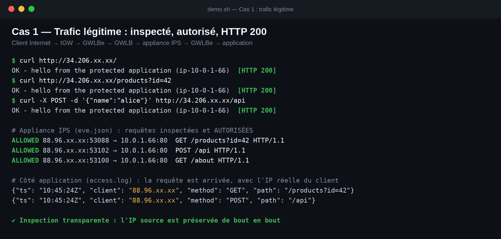
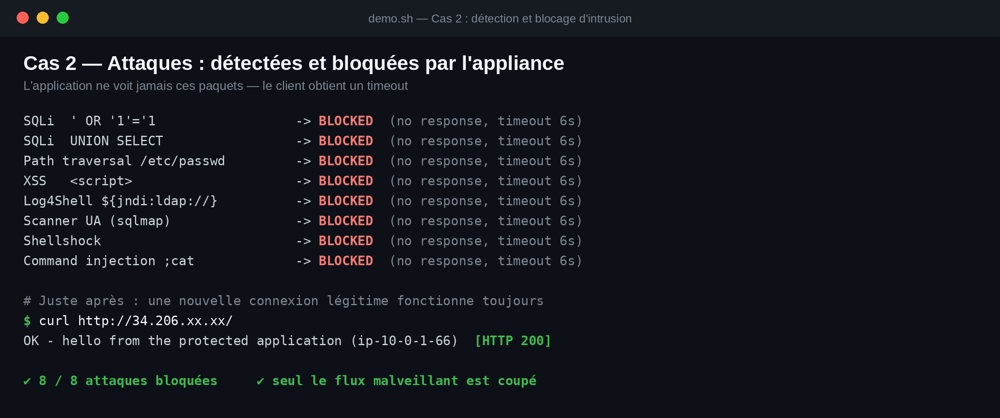
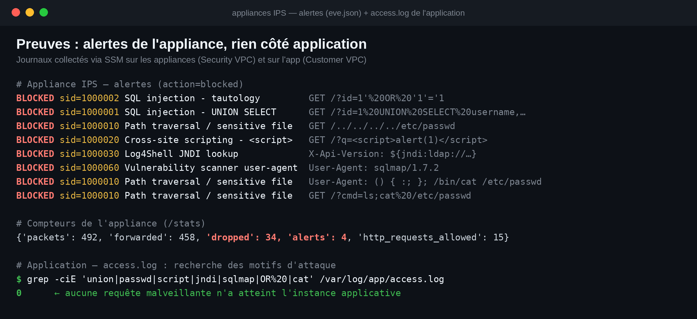

# AWS Gateway Load Balancer — inspection réseau transparente avec Terraform

Infrastructure as Code complète pour une architecture **Gateway Load Balancer endpoint (GWLBe)** : tout le trafic
d'un *Customer VPC* (entrant **et** sortant) est redirigé de façon transparente vers un *Security Service VPC* où des
appliances de sécurité l'inspectent via **GENEVE (UDP 6081)** avant de l'autoriser ou de l'abandonner.

Le dépôt contient le Terraform, une appliance IPS légère (Python) et une démonstration scriptée avec deux cas
d'acceptation : **trafic légitime autorisé** et **attaques détectées et bloquées**.


## Sommaire

- [Ce qui est déployé](#ce-qui-est-déployé)
- [Comment le trafic circule](#comment-le-trafic-circule)
- [Démarrage rapide](#démarrage-rapide)
- [La démonstration](#la-démonstration)
- [L'appliance IPS](#lappliance-ips)
- [Sécurité réseau (SG / NACL)](#sécurité-réseau-sg--nacl)
- [Variables](#variables)
- [Structure du dépôt](#structure-du-dépôt)
- [Limites et passage en production](#limites-et-passage-en-production)
- [Coûts](#coûts)
- [Nettoyage](#nettoyage)
- [Documentation complémentaire](#documentation-complémentaire)

## Ce qui est déployé

47 ressources AWS (région par défaut `us-east-1`, une seule AZ) :

| Domaine | Ressources | Fichier |
|---|---|---|
| **Customer VPC** `10.0.0.0/16` | IGW, subnet **public** (GWLBe), subnet **privé** (application) | [vpc.tf](vpc.tf) |
| **Security Service VPC** `10.1.0.0/16` | IGW (gestion/SSM uniquement), subnet GWLB, subnet appliances | [vpc.tf](vpc.tf) |
| **GWLB** | Gateway Load Balancer, target group `GENEVE:6081`, listener, health check HTTP `:8080` | [gwlb.tf](gwlb.tf) |
| **PrivateLink** | VPC Endpoint Service adossé au GWLB + **GWLB Endpoint** dans le Customer VPC | [gwlb.tf](gwlb.tf) |
| **Routage** | Table d'entrée de l'IGW (*edge association*), tables des subnets public / privé / appliances | [routing.tf](routing.tf) |
| **Sécurité réseau** | Security Groups + NACLs explicites (stateless, dans les deux sens) | [security.tf](security.tf) |
| **Calcul** | 1 EC2 applicative (+ EIP), `N` EC2 appliances IPS (défaut 2) | [ec2.tf](ec2.tf), [templates/](templates/) |
| **Accès** | Rôle IAM + SSM Session/Run Command (pas de clé SSH, aucun port d'admin ouvert), IMDSv2 imposé | [iam.tf](iam.tf) |

## Comment le trafic circule

Le principe : aucune route ne permet d'atteindre l'application sans passer par le GWLBe.

| Table de routage | Route | Rôle |
|---|---|---|
| IGW (*edge association*) | `10.0.1.0/24 → GWLBe` | Le trafic **entrant** vers l'app est dévié vers l'inspection |
| Subnet privé (app) | `0.0.0.0/0 → GWLBe` | Le trafic **sortant** de l'app est inspecté aussi |
| Subnet public (GWLBe) | `0.0.0.0/0 → IGW` + `local` | Après inspection : livraison locale (entrant) ou sortie Internet (sortant) |

Chemin d'une requête entrante :

1. Le client atteint l'EIP de l'application ; l'IGW traduit vers l'IP privée puis consulte sa table d'entrée → **GWLBe**.
2. Le GWLBe envoie le paquet au **GWLB** (PrivateLink), qui l'encapsule en **GENEVE** (UDP 6081) vers une appliance
   (répartition par flux, *flow stickiness* 5-tuple).
3. L'appliance décapsule, inspecte le payload, puis **renvoie** le paquet inchangé au GWLB (autorisé) ou **l'abandonne** (bloqué).
4. Le GWLB rend le paquet au GWLBe, qui le livre à l'application par la route locale. L'**IP source du client est préservée**.

La réponse de l'application suit le chemin inverse (`0.0.0.0/0 → GWLBe`), donc les deux sens du flux passent par la même appliance.

Détails et schéma des flux : [docs/architecture.md](docs/architecture.md).

## Démarrage rapide

**Prérequis** : Terraform ≥ 1.5, AWS CLI v2, `curl`, `jq`, des identifiants AWS (variables d'environnement ou profil)
avec les droits EC2 / ELB / IAM / SSM. Aucune clé n'est stockée dans le dépôt.

```bash
export AWS_PROFILE=...          # ou AWS_ACCESS_KEY_ID / AWS_SECRET_ACCESS_KEY
export AWS_REGION=us-east-1

terraform init
terraform plan -out=tfplan      # → Plan: 47 to add
terraform apply tfplan          # ~3 min (le GWLB endpoint prend ~2 min)
```

Attendez que les cibles soient saines et que l'application réponde (1 à 3 minutes après l'apply) :

```bash
aws elbv2 describe-target-health --target-group-arn "$(terraform output -raw target_group_arn)"
curl -i "$(terraform output -raw app_url)"
```

Lancer la démonstration complète (les deux cas + collecte des preuves via SSM) :

```bash
./scripts/demo.sh | tee demo_output.txt
```

Tester l'appliance **sans AWS** (paquets GENEVE forgés en local, nécessite root pour le socket brut) :

```bash
sudo python3 tests/test_ips.py
```

## La démonstration

### Cas d'acceptation 1 — trafic légitime

Requêtes HTTP normales depuis Internet : inspectées par l'appliance, autorisées, **HTTP 200** de l'application,
qui voit l'IP réelle du client.



### Cas d'acceptation 2 — détection et blocage d'intrusion

8 attaques (SQLi ×2, traversée de chemin, XSS, Log4Shell, scanner sqlmap, Shellshock, injection de commande) :
**8/8 détectées et abandonnées** par l'appliance. Le client n'obtient aucune réponse (timeout) et le journal de
l'application ne contient **aucune** de ces requêtes. Une connexion légitime lancée juste après fonctionne normalement.





Rapport complet (commandes, résultats, incident rencontré) : [docs/demo-report.md](docs/demo-report.md) ·
sortie brute : [docs/demo_output.txt](docs/demo_output.txt) (IP publiques masquées).

## L'appliance IPS

[templates/ips.py](templates/ips.py) est un IPS volontairement minimaliste (Python standard library, ~230 lignes) qui
illustre le contrat entre un GWLB et une appliance :

- écoute UDP **6081**, décapsule GENEVE (charge utile IPv4 `0x0800` ou Ethernet `0x6558`) ;
- inspecte le payload TCP (URL-décodé) avec **9 signatures** : SQLi (×3), traversée de chemin, XSS, Log4Shell,
  Shellshock, injection de commande, user-agents de scanners ;
- **autorisé** → le datagramme GENEVE est renvoyé au GWLB, TLV et *flow cookie* intacts ;
  **bloqué** → abandonné, et le flux (5-tuple) est coupé 120 s pour que les retransmissions TCP ne passent pas non plus ;
- journal JSON `/var/log/gwlb-ips/eve.json`, et sur le port TCP `8080` : `/health` (health check du GWLB) et `/stats`.

> **Point d'attention essentiel** — pour renvoyer un paquet au GWLB, l'appliance doit inverser les adresses IP
> externes mais **conserver les ports UDP externes** (source = port utilisé par le GWLB, destination = 6081).
> Un socket UDP classique ne peut pas choisir ce port source : `ips.py` construit donc l'en-tête UDP à la main sur un
> **socket brut**. Si les ports sont inversés, les cibles restent « healthy » mais **tout le trafic est silencieusement
> abandonné**. Voir [docs/troubleshooting.md](docs/troubleshooting.md).

## Sécurité réseau (SG / NACL)

| Cible | Entrant autorisé | Notes |
|---|---|---|
| SG application | TCP 80 depuis `app_allowed_cidrs` ; ICMP | Sortie libre |
| SG appliances | **UDP 6081** et **TCP 8080** depuis le CIDR du Security VPC uniquement | Aucun SSH ; accès par SSM |
| NACL Customer VPC | TCP 80/443, éphémères TCP/UDP 1024-65535, ICMP | Sortie libre |
| NACL Security VPC | **UDP 6081**, UDP 1024-65535 (retour GENEVE), TCP 8080 depuis le VPC ; éphémères pour SSM/DNS | Sortie libre |

Les NACL étant *stateless*, les ports de retour sont autorisés explicitement.

## Variables

| Variable | Défaut | Description |
|---|---|---|
| `region` | `us-east-1` | Région AWS |
| `project` | `gwlb-demo` | Préfixe des noms / tag |
| `availability_zone` | `null` (1ʳᵉ AZ dispo) | AZ unique de la démo |
| `customer_vpc_cidr` | `10.0.0.0/16` | CIDR du Customer VPC |
| `customer_gwlbe_subnet_cidr` | `10.0.0.0/24` | Subnet public (GWLBe) |
| `customer_app_subnet_cidr` | `10.0.1.0/24` | Subnet privé (application) |
| `security_vpc_cidr` | `10.1.0.0/16` | CIDR du Security VPC |
| `security_gwlb_subnet_cidr` | `10.1.1.0/24` | Subnet des nœuds GWLB |
| `security_appliance_subnet_cidr` | `10.1.0.0/24` | Subnet des appliances |
| `app_allowed_cidrs` | `["0.0.0.0/0"]` | Sources autorisées sur HTTP/80 — **à restreindre** hors démo |
| `appliance_count` | `2` | Nombre d'appliances derrière le GWLB |
| `instance_type` | `t3.micro` | Type d'instance (app + appliances) |

Exemple : [terraform.tfvars.example](terraform.tfvars.example).

Sorties : `app_public_ip`, `app_url`, `app_instance_id`, `appliance_instance_ids`, `gwlb_arn`, `target_group_arn`,
`gwlb_endpoint_id`, `endpoint_service_name`, `customer_vpc_id`, `security_vpc_id`.

## Structure du dépôt

```
.
├── main.tf  variables.tf  outputs.tf      # provider, variables, sorties
├── vpc.tf                                 # Customer VPC + Security VPC
├── gwlb.tf                                # GWLB, target group, endpoint service, GWLBe
├── routing.tf                             # tables de routage + edge association
├── security.tf                            # Security Groups + NACLs
├── iam.tf  ec2.tf                         # rôle SSM, appliances, application, EIP
├── templates/
│   ├── ips.py                             # appliance IPS GENEVE
│   ├── app.py                             # application de démo (journalise ce qu'elle reçoit)
│   └── *_userdata.sh.tpl                  # bootstrap cloud-init (systemd)
├── scripts/demo.sh                        # démonstration des 2 cas + preuves
├── tests/test_ips.py                      # test local de l'appliance (sans AWS)
├── docs/                                  # architecture, rapport de démo, dépannage, images
└── .gitlab-ci.yml                         # fmt + validate + test de l'appliance
```

## Limites et passage en production

Ce dépôt est une **démonstration pédagogique**, pas une architecture de production.

- **IPS minimal** : signatures simples, inspection **paquet par paquet** (pas de réassemblage TCP), HTTP en clair
  uniquement (pas d'inspection TLS). En production : Suricata, Palo Alto, Fortinet, Check Point, AWS Network Firewall…
  derrière le même GWLB — l'infrastructure Terraform reste valable.
- **Blocage par abandon** : le client voit un timeout, pas une page 403.
- **Une seule AZ** : en production, un GWLBe par AZ et des appliances dans chaque AZ ; envisager
  `enable_cross_zone_load_balancing` selon le besoin.
- **Application exposée** : l'EIP rend l'app joignable depuis Internet (le subnet n'a toutefois aucune route directe
  vers l'IGW). Restreignez `app_allowed_cidrs`, ou placez un ALB/NLB devant en production.
- **Appliances avec IP publique** (pour SSM/paquets) : préférez des endpoints VPC SSM ou un NAT.
- **État Terraform local** : utilisez un backend distant (S3 + verrouillage) pour du travail en équipe.
- **MTU** : le GWLB supporte 8500 octets, l'encapsulation GENEVE ajoute 68 octets (l'appliance doit accepter ≥ 8568).

## Coûts

Estimation `us-east-1`, hors trafic : 3 × `t3.micro` + GWLB + GWLBe + EIP ≈ **2 $/jour**. Pensez à détruire la stack
après usage.

## Nettoyage

```bash
terraform destroy
```

## Documentation complémentaire

- [docs/architecture.md](docs/architecture.md) — flux détaillés, routage, contrat GWLB ↔ appliance
- [docs/demo-report.md](docs/demo-report.md) — rapport de démonstration et résultats des tests
- [docs/troubleshooting.md](docs/troubleshooting.md) — pièges rencontrés et méthode de diagnostic

## Licence

[MIT](LICENSE)
