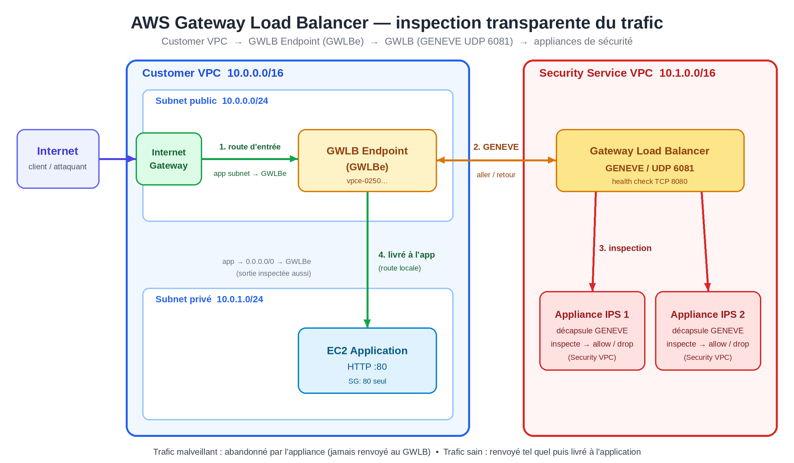

# Transparent Network Inspection on AWS with Gateway Load Balancer (Terraform)

Complete Infrastructure as Code for an **AWS Gateway Load Balancer endpoint (GWLBe)** architecture: all traffic of a
*Customer VPC* (inbound **and** outbound) is transparently steered to a *Security Service VPC*, where security
appliances inspect it over **GENEVE (UDP 6081)** before allowing or dropping it.

The repository contains the Terraform code, a lightweight IPS appliance (Python) and a scripted demo with two
acceptance cases: **legitimate traffic allowed** and **attacks detected and blocked**.



## Table of contents

- [What gets deployed](#what-gets-deployed)
- [How traffic flows](#how-traffic-flows)
- [Quick start](#quick-start)
- [The demo](#the-demo)
- [The IPS appliance](#the-ips-appliance)
- [Network security (SG / NACL)](#network-security-sg--nacl)
- [Variables and outputs](#variables-and-outputs)
- [Repository layout](#repository-layout)
- [Limitations and going to production](#limitations-and-going-to-production)
- [Cost](#cost)
- [Cleanup](#cleanup)
- [Further reading](#further-reading)

## What gets deployed

47 AWS resources (default region `us-east-1`, single AZ):

| Area | Resources | File |
|---|---|---|
| **Customer VPC** `10.0.0.0/16` | IGW, **public** subnet (GWLBe), **private** subnet (application) | [vpc.tf](vpc.tf) |
| **Security Service VPC** `10.1.0.0/16` | IGW (management/SSM only), GWLB subnet, appliance subnet | [vpc.tf](vpc.tf) |
| **GWLB** | Gateway Load Balancer, `GENEVE:6081` target group, listener, HTTP health check on `:8080` | [gwlb.tf](gwlb.tf) |
| **PrivateLink** | VPC Endpoint Service backed by the GWLB + **GWLB Endpoint** in the Customer VPC | [gwlb.tf](gwlb.tf) |
| **Routing** | IGW ingress route table (*edge association*), public / private / appliance subnet route tables | [routing.tf](routing.tf) |
| **Network security** | Security Groups + explicit NACLs (stateless, both directions) | [security.tf](security.tf) |
| **Compute** | 1 application EC2 (+ EIP), `N` IPS appliance EC2s (default 2) | [ec2.tf](ec2.tf), [templates/](templates/) |
| **Access** | IAM role + SSM Run Command (no SSH key, no admin port open), IMDSv2 enforced | [iam.tf](iam.tf) |

## How traffic flows

The principle: no route reaches the application without going through the GWLBe.

| Route table | Route | Purpose |
|---|---|---|
| IGW (*edge association*) | `10.0.1.0/24 → GWLBe` | **Inbound** traffic to the app is diverted to inspection |
| Private subnet (app) | `0.0.0.0/0 → GWLBe` | **Outbound** traffic from the app is inspected too |
| Public subnet (GWLBe) | `0.0.0.0/0 → IGW` + `local` | After inspection: local delivery (inbound) or Internet egress (outbound) |

Path of an inbound request:

1. The client hits the application's EIP; the IGW translates it to the private IP, then consults its ingress route table → **GWLBe**.
2. The GWLBe forwards the packet to the **GWLB** (PrivateLink), which wraps it in **GENEVE** (UDP 6081) and sends it to an
   appliance (per-flow distribution, 5-tuple flow stickiness).
3. The appliance decapsulates and inspects the payload, then either **returns** the unchanged packet to the GWLB (allowed)
   or **drops** it (blocked).
4. The GWLB hands the packet back to the GWLBe, which delivers it to the application over the local route. The
   **client's source IP is preserved** end to end.

The application's reply takes the reverse path (`0.0.0.0/0 → GWLBe`), so both directions of a flow go through the same appliance.

More detail and flow diagrams: [docs/architecture.md](docs/architecture.md) *(in French)*.

## Quick start

**Prerequisites**: Terraform ≥ 1.5, AWS CLI v2, `curl`, `jq`, and AWS credentials (environment variables or a profile)
with EC2 / ELB / IAM / SSM permissions. No secret is stored in this repository.

```bash
export AWS_PROFILE=...          # or AWS_ACCESS_KEY_ID / AWS_SECRET_ACCESS_KEY
export AWS_REGION=us-east-1

terraform init
terraform plan -out=tfplan      # → Plan: 47 to add
terraform apply tfplan          # ~3 min (the GWLB endpoint takes ~2 min)
```

Wait until the targets are healthy and the application answers (1–3 minutes after apply):

```bash
aws elbv2 describe-target-health --target-group-arn "$(terraform output -raw target_group_arn)"
curl -i "$(terraform output -raw app_url)"
```

Run the full demo (both cases + evidence collection over SSM):

```bash
./scripts/demo.sh | tee demo_output.txt
```

Test the appliance **without AWS** (crafted GENEVE packets locally; needs root for the raw socket):

```bash
sudo python3 tests/test_ips.py
```

## The demo

### Acceptance case 1 — legitimate traffic

Normal HTTP requests from the Internet: inspected by the appliance, allowed, **HTTP 200** from the application, which
sees the real client IP.


### Acceptance case 2 — intrusion detection and blocking

8 attacks (SQLi ×2, path traversal, XSS, Log4Shell, sqlmap scanner, Shellshock, command injection):
**8/8 detected and dropped** by the appliance. The client gets no response (timeout) and the application log
contains **none** of these requests. A legitimate request sent right afterwards works normally.


Full report (commands, results, incident encountered): [docs/demo-report.md](docs/demo-report.md) *(in French)* ·
raw output: [docs/demo_output.txt](docs/demo_output.txt) (public IPs masked).

## The IPS appliance

[templates/ips.py](templates/ips.py) is a deliberately minimal IPS (Python standard library only, ~230 lines) that
illustrates the contract between a GWLB and an appliance:

- listens on UDP **6081** and decapsulates GENEVE (IPv4 payload `0x0800` or Ethernet `0x6558`);
- inspects the (URL-decoded) TCP payload against **9 signatures**: SQLi (×3), path traversal, XSS, Log4Shell,
  Shellshock, command injection, scanner user-agents;
- **allowed** → the GENEVE datagram is returned to the GWLB with TLVs and *flow cookie* intact;
  **blocked** → dropped, and the flow (5-tuple) is cut for 120 s so TCP retransmissions don't get through either;
- JSON log at `/var/log/gwlb-ips/eve.json`, and on TCP `8080`: `/health` (GWLB health check) and `/stats`.

> **Key gotcha** — to return a packet to the GWLB, the appliance must swap the outer IP addresses but **keep the outer
> UDP ports unchanged** (source = port the GWLB used, destination = 6081). A regular UDP socket can't choose that source
> port, so `ips.py` builds the UDP header by hand on a **raw socket**. If the ports are swapped, the targets stay
> "healthy" but **all traffic is silently dropped**. See [docs/troubleshooting.md](docs/troubleshooting.md) *(in French)*.

## Network security (SG / NACL)

| Target | Inbound allowed | Notes |
|---|---|---|
| Application SG | TCP 80 from `app_allowed_cidrs`; ICMP | Unrestricted egress |
| Appliance SG | **UDP 6081** and **TCP 8080** from the Security VPC CIDR only | No SSH; access through SSM |
| Customer VPC NACL | TCP 80/443, ephemeral TCP/UDP 1024-65535, ICMP | Unrestricted egress |
| Security VPC NACL | **UDP 6081**, UDP 1024-65535 (GENEVE return), TCP 8080 from the VPC; ephemeral ports for SSM/DNS | Unrestricted egress |

NACLs being stateless, return ports are allowed explicitly.

## Variables and outputs

| Variable | Default | Description |
|---|---|---|
| `region` | `us-east-1` | AWS region |
| `project` | `gwlb-demo` | Name prefix / tag |
| `availability_zone` | `null` (first available) | Single AZ used by the demo |
| `customer_vpc_cidr` | `10.0.0.0/16` | Customer VPC CIDR |
| `customer_gwlbe_subnet_cidr` | `10.0.0.0/24` | Public subnet (GWLBe) |
| `customer_app_subnet_cidr` | `10.0.1.0/24` | Private subnet (application) |
| `security_vpc_cidr` | `10.1.0.0/16` | Security VPC CIDR |
| `security_gwlb_subnet_cidr` | `10.1.1.0/24` | GWLB nodes subnet |
| `security_appliance_subnet_cidr` | `10.1.0.0/24` | Appliances subnet |
| `app_allowed_cidrs` | `["0.0.0.0/0"]` | Sources allowed on HTTP/80 — **restrict this outside a demo** |
| `appliance_count` | `2` | Number of appliances behind the GWLB |
| `instance_type` | `t3.micro` | Instance type (app + appliances) |

Example: [terraform.tfvars.example](terraform.tfvars.example).

Outputs: `app_public_ip`, `app_url`, `app_instance_id`, `appliance_instance_ids`, `gwlb_arn`, `target_group_arn`,
`gwlb_endpoint_id`, `endpoint_service_name`, `customer_vpc_id`, `security_vpc_id`.

## Repository layout

```
.
├── main.tf  variables.tf  outputs.tf      # provider, variables, outputs
├── vpc.tf                                 # Customer VPC + Security VPC
├── gwlb.tf                                # GWLB, target group, endpoint service, GWLBe
├── routing.tf                             # route tables + edge association
├── security.tf                            # Security Groups + NACLs
├── iam.tf  ec2.tf                         # SSM role, appliances, application, EIP
├── templates/
│   ├── ips.py                             # GENEVE IPS appliance
│   ├── app.py                             # demo application (logs what it receives)
│   └── *_userdata.sh.tpl                  # cloud-init bootstrap (systemd)
├── scripts/demo.sh                        # two-case demo + evidence
├── tests/test_ips.py                      # local appliance test (no AWS needed)
├── docs/                                  # architecture, demo report, troubleshooting, images
└── .github/workflows/ci.yml               # fmt + validate + appliance test
```

## Limitations and going to production

This repository is an **educational demo**, not a production architecture.

- **Minimal IPS**: simple signatures, **packet-by-packet** inspection (no TCP reassembly), plaintext HTTP only (no TLS
  inspection). In production use Suricata, Palo Alto, Fortinet, Check Point, AWS Network Firewall… behind the same GWLB —
  the Terraform infrastructure stays valid.
- **Blocking = packet drop**: the client sees a timeout, not a 403 page.
- **Single AZ**: in production, one GWLBe per AZ and appliances in every AZ; consider
  `enable_cross_zone_load_balancing` depending on your needs.
- **Exposed application**: the EIP makes the app reachable from the Internet (the subnet itself has no direct route to
  the IGW). Restrict `app_allowed_cidrs`, or put an ALB/NLB in front in production.
- **Appliances with public IPs** (for SSM/packages): prefer SSM VPC endpoints or a NAT.
- **Local Terraform state**: use a remote backend (S3 + locking) when working in a team.
- **MTU**: the GWLB supports 8500 bytes and GENEVE encapsulation adds 68 bytes (the appliance must accept ≥ 8568).

## Cost

Estimate for `us-east-1`, excluding traffic: 3 × `t3.micro` + GWLB + GWLBe + EIP ≈ **$2/day**. Destroy the stack when
you are done.

## Cleanup

```bash
terraform destroy
```

`terraform destroy` needs **delete permissions** on EC2 (including `DeleteVpcEndpoints` and
`ReplaceNetworkAclAssociation`), ELB and IAM (`DetachRolePolicy`, `RemoveRoleFromInstanceProfile`, role and instance
profile deletion). With a restricted lab user that can create resources but not delete them, the destroy stops halfway
(the instances are terminated, but the GWLB, GWLBe, VPCs and IAM role remain) — use an identity with the required
permissions to finish it.

## Further reading

The detailed documentation is written in French:

- [docs/architecture.md](docs/architecture.md) — detailed flows, routing, GWLB ↔ appliance contract
- [docs/demo-report.md](docs/demo-report.md) — demo report and test results
- [docs/troubleshooting.md](docs/troubleshooting.md) — pitfalls encountered and diagnosis method

## License

[MIT](LICENSE)
