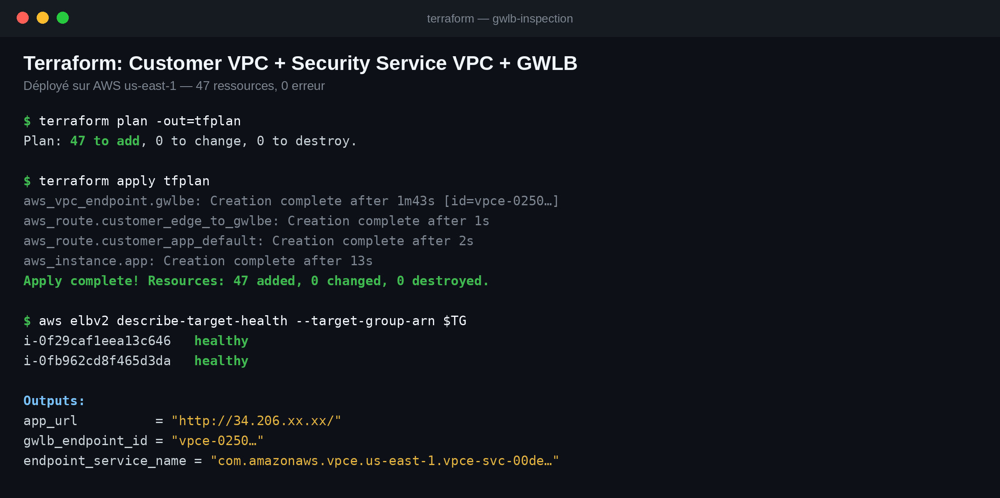
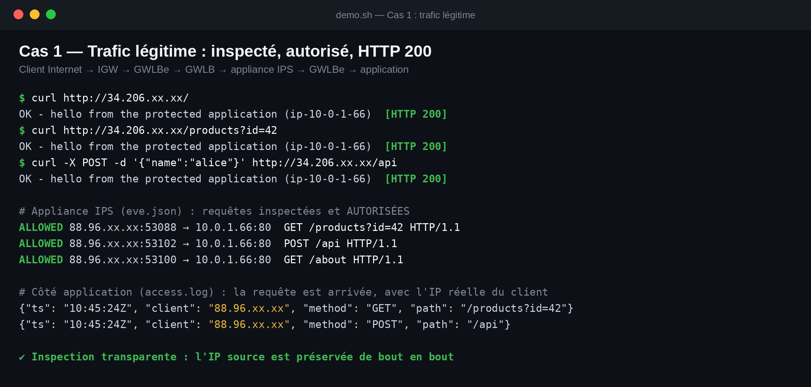
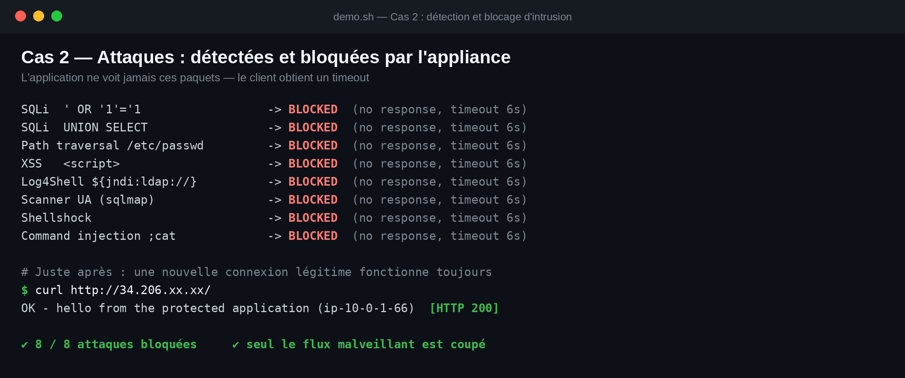
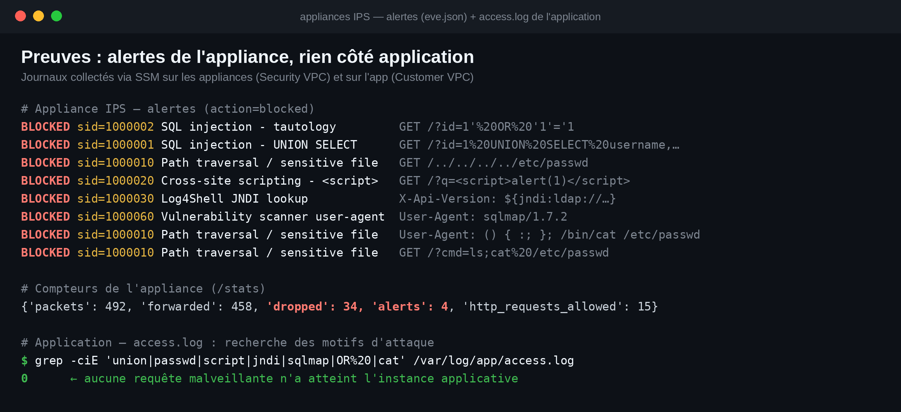

# Rapport de démonstration

Déployé le 2026-11-09 en `us-east-1` avec Terraform 1.17.1 (provider AWS ~> 5.0). Sortie brute de la démonstration :
[demo_output.txt](demo_output.txt) (IP publiques masquées).

## Déploiement

```bash
terraform init
terraform fmt -recursive && terraform validate          # Success
terraform plan -out=tfplan                               # Plan: 47 to add
terraform apply tfplan                                   # Apply complete: 47 added
# correction de l'appliance (voir « Incident » ci-dessous)
terraform plan -out=tfplan2 && terraform apply tfplan2   # 4 remplacements (2 appliances + 2 attachements)
./scripts/demo.sh | tee demo_output.txt
```



## Cas d'acceptation 1 — trafic légitime : réussi

| Requête | Résultat |
|---|---|
| `GET /`, `GET /products?id=42`, `GET /about` | HTTP 200 |
| `POST /api` (JSON) | HTTP 200 |

Preuves :

- les appliances journalisent `event_type=http, action=allowed` pour chaque requête (VNI 0) ;
- l'application journalise les mêmes requêtes avec l'**IP réelle du client** : l'inspection est transparente.



## Cas d'acceptation 2 — détection et blocage d'intrusion : réussi (8/8)

| Attaque | Réponse client | Signature déclenchée |
|---|---|---|
| SQLi `' OR '1'='1` | timeout | 1000002 — tautologie SQL |
| SQLi `UNION SELECT` | timeout | 1000001 — UNION SELECT |
| Traversée `/../../../../etc/passwd` | timeout | 1000010 — chemin / fichier sensible |
| XSS `<script>` | timeout | 1000020 — XSS |
| Log4Shell `${jndi:ldap://…}` | timeout | 1000030 — JNDI |
| User-agent `sqlmap` | timeout | 1000060 — user-agent de scanner |
| Shellshock | timeout | 1000010 (voir note) |
| Injection `;cat /etc/passwd` | timeout | 1000010 (voir note) |

Preuves :

- 8 alertes `action=blocked` (réparties par flux : 4 par appliance) ; `/stats` : `alerts=4`, `dropped=34` sur chaque appliance ;
- le **journal d'accès de l'application ne contient aucune requête malveillante** (0 correspondance sur les motifs d'attaque) ;
- une **nouvelle connexion légitime** juste après les attaques renvoie HTTP 200 : seul le flux malveillant est coupé.





Note : Shellshock et l'injection `;cat` sont arrêtés par la signature « /etc/passwd », évaluée avant les signatures dédiées
(première correspondance). Le blocage est correct ; seule l'étiquette est moins précise.

## Incident rencontré et corrigé

Au premier déploiement, les appliances étaient `healthy` mais l'application était injoignable (et sans accès SSM).
L'appliance renvoyait les paquets GENEVE avec les ports UDP externes **inversés**, alors que le GWLB exige qu'ils soient
**conservés** : il abandonnait silencieusement toutes les réponses. Correctif : socket brut avec en-tête UDP construit à la
main. Le détail de la démarche de diagnostic est dans [troubleshooting.md](troubleshooting.md).

## Limites

- IPS de démonstration : signatures simples, inspection paquet par paquet, HTTP uniquement.
- Blocage par abandon : le client voit un timeout, pas un 403.
- Une seule AZ.
- Le journal d'accès de l'application contient aussi des requêtes de diagnostic et un scanner Internet externe qui a
  atteint l'EIP pendant le test.
